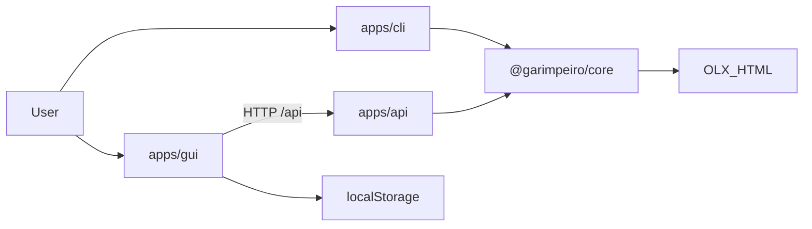
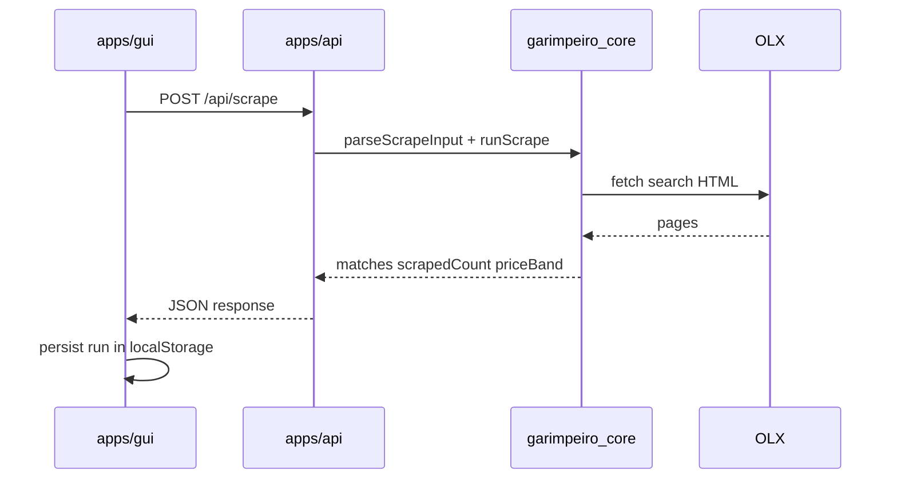

<!--
Heimdall — portfolio README (add-detailed-readme)
Display brand: Heimdall | npm packages / CLI: @garimpeiro/*, garimpeiro
-->

<div align="center">


# Heimdall

### Watch the OLX marketplace. Catch the right price.

[](LICENSE)
[](https://nodejs.org/)
[](https://www.typescriptlang.org/)
[](package.json)

<br />

[](https://fastify.dev/)
[](https://react.dev/)
[](https://vitejs.dev/)
[](https://www.docker.com/)

**[English](#english)** · **[Português](#português)**

<br />


<p><sub>Local product shell: dashboard KPIs, last search, offers preview, and execution history (browser workspace). Screenshot may still show the former display name on the sidebar while packaging remains <code>@garimpeiro/*</code>.</sub></p>

</div>

---

<a id="english"></a>

# 🇺🇸 English

## Table of Contents

- [Overview](#overview)
- [Features and usability](#features-and-usability)
- [Technical stack](#technical-stack)
- [Architecture](#architecture)
- [Current implementation notes](#current-implementation-notes)
- [Project structure](#project-structure)
- [Getting started](#getting-started)
- [Usage](#usage)
- [API reference](#api-reference)
- [Development](#development)
- [Deployment and operations](#deployment-and-operations)
- [Security](#security)
- [Limitations](#limitations)
- [Troubleshooting](#troubleshooting)
- [Roadmap](#roadmap)
- [Contributing](#contributing)
- [License](#license)
- [Contact](#contact)

---

## Overview

### What is Heimdall?

Heimdall is a **personal OLX price scout**. It builds Brazilian OLX search URLs, fetches listing HTML, extracts ads, and keeps only those inside a configurable **price band** around a target price.

You can run it as:

1. A **CLI watcher** (`@garimpeiro/cli`) with a polling loop and log/desktop notifications, or
2. A **local web product** (`apps/gui` + `@garimpeiro/api`) for one-shot scrapes, KPIs, saved searches, and history.

Shared scrape/match logic lives in `@garimpeiro/core`. The UI/README display name is **Heimdall**; package and binary names remain under the historical `@garimpeiro` / `garimpeiro` identifiers.

### Motivation

| | |
| --- | --- |
| **Problem** | Manually refreshing OLX and comparing prices is slow; good deals are easy to miss. |
| **Context** | Classified inventory changes quickly; a tight price window often matters more than raw listing volume. |
| **Approach** | Automate fetch + band filtering; notify on matches; optionally explore results in a dashboard. |
| **Audience** | Individual developers / power users running the tool locally for personal searches. |

### Goals

- Dependable scrape → extract → match pipeline for OLX search pages
- Clear boundaries between core, CLI, API, and GUI
- Practical local DX (npm workspaces, Makefile, Docker Compose)
- A portfolio-visible product surface (branding + SaaS-like shell), not only a script

### Scope

| In scope | Out of scope |
| --- | --- |
| One-shot and looped scrapes | Multi-tenant SaaS / accounts |
| Price-band matching | Official OLX partner API |
| CLI log + desktop notifications | Cloud always-on workers as a service |
| GUI workspace in `localStorage` | Billing, orgs, push notifications |
| Docker Compose for API + GUI | Native mobile apps |

---

## Features and usability

### Implemented capabilities

| Capability | Status | Where |
| --- | --- | --- |
| Search URL construction (UF, DDD/region, zone, city, product, order, pages) | Implemented | `@garimpeiro/core` |
| HTML fetch + ad extraction | Implemented | core (`got-scraping`, JSDOM) |
| Price-band filtering (`percentual`) | Implemented | core |
| CLI polling loop + stop-on-match | Implemented | `@garimpeiro/cli` |
| Log and desktop notifications | Implemented | CLI (`chalk`, `node-notifier`) |
| HTTP scrape API | Implemented | `@garimpeiro/api` |
| GUI dashboard, offers table, saved searches, history, preferences | Implemented | `apps/gui` (client persistence) |
| Docker dev / prod-ish stacks | Implemented | Compose + Makefile |

### Actors and journeys

**CLI user** — configure flags once, leave a loop running, get notified when ads fall in band.

```text
flags → parseScrapeInput → fetch pages → match band → notify → wait interval → repeat
```

**GUI user** — open the shell, run **Nova busca**, review **Ofertas** / dashboard KPIs, optionally save criteria and reopen from **Histórico** / **Buscas salvas**.

```text
form → POST /api/scrape → matches + KPIs → localStorage history → table / dashboard
```

Detailed CLI options: [docs/cli/README.md](docs/cli/README.md). GUI notes: [apps/gui/README.md](apps/gui/README.md).

---

## Technical stack

| Responsibility | Technology | Role |
| --- | --- | --- |
| Runtime | Node.js ≥ 22, TypeScript, ESM | Declared in root `package.json` `engines` |
| Monorepo | npm workspaces | `packages/*`, `apps/*` |
| Domain | `@garimpeiro/core`, tsup, JSDOM, got-scraping | URLs, scrape, match, browser entry |
| CLI | yargs, date-fns, chalk, node-notifier | Argv, loop timing, notifications |
| API | Fastify, `@fastify/cors` | `/api/health`, `/api/scrape` |
| GUI | React 19, Vite 6, react-router-dom | Local SaaS shell |
| Ops | Docker Compose, nginx, Makefile | Dev hot reload and static GUI + API proxy |

No application database. GUI state is browser `localStorage` only.

---

## Architecture





- **CLI** imports core in-process (no HTTP).
- **GUI** must not import the Node scrape entry; it uses HTTP + `@garimpeiro/core/browser`.
- **Apps do not import each other.** Preferred build order: core → cli / api / gui.

---

## Current implementation notes

There is **no** `docs/adr/` tree. Observable choices (not formal ADRs):

- **Workspace isolation** — apps resolve `@garimpeiro/core` from the package, not relative `../../packages` tsconfig references.
- **Browser entry** — GUI-safe exports under `@garimpeiro/core/browser`.
- **GUI persistence** — saved searches / runs are client-only; the API is scrape-only.
- **Display vs package naming** — Heimdall branding in UI/README; npm scope remains `@garimpeiro/*`.

Formal ADRs under `docs/adr/` would be a documentation improvement, not something claimed as existing.

---

## Project structure

```text
garimpeiro-olx/
├── public/                 # heimdall_icon.png, cover.png
├── docs/cli/               # CLI option documentation
├── packages/core/          # @garimpeiro/core
├── apps/
│   ├── cli/                # @garimpeiro/cli (bin: garimpeiro)
│   ├── api/                # @garimpeiro/api
│   └── gui/                # Vite + React SPA
├── docker-compose.yml
├── docker-compose.dev.yml
├── Makefile
├── package.json
└── LICENSE
```

---

## Getting started

### Prerequisites

- Node.js **22+**
- npm (workspaces)
- Optional (CLI desktop notifications on Linux): `notify-osd` or `libnotify-bin` — see [node-notifier requirements](https://github.com/mikaelbr/node-notifier#requirements)
- Optional: Docker Engine + Docker Compose for `make dev` / `make up`

### Install and build

```sh
git clone https://github.com/mrocha98/garimpeiro-olx.git
cd garimpeiro-olx
npm install
npm run build                 # core → cli → api
npm run build -w gui          # GUI production bundle
# or
make build                    # core → cli → api → gui
```

No `.env` is required for the default local scrape path.

### Verify API health (after starting the API)

```sh
# example once API is listening on :3000
curl -s http://localhost:3000/api/health
# expected: {"ok":true}
```

---

## Usage

### CLI (continuous watch)

```sh
npm start -- --help

npm start -- \
  --uf sp \
  --ddd 12 \
  --zona 'vale do paraiba' \
  --cidade 'sao jose dos campos' \
  --produto apartamento \
  --preco 300000
```

Reload during development:

```sh
make cli-dev -- --uf sp --ddd 12 --produto apartamento --preco 300000
```

Option groups: [docs/cli/README.md](docs/cli/README.md).

### GUI + API

```sh
make dev      # API + Vite → http://localhost:5173
npm run dev:gui   # host alternative (API + GUI via concurrently)
make up       # production-style stack → GUI http://localhost:8080
make down
```

---

## API reference

Default local base URL: `http://localhost:3000`

### `GET /api/health`

Response:

```json
{ "ok": true }
```

### `POST /api/scrape`

Request body (JSON):

| Field | Required | Description |
| --- | --- | --- |
| `uf` | yes | State slug |
| `ddd` | yes | Region DDD |
| `produto` | yes | Search query |
| `preco` | yes | Target price |
| `zona` | no* | Zone path segment |
| `cidade` | no* | City path segment (*city requires zone) |
| `percentual` | no | Band width percent |
| `ordem` | no | OLX sort label |
| `paginas` | no | Number of pages |

Success response:

```json
{
  "matches": [{ "title": "…", "price": 0, "link": "https://…" }],
  "scrapedCount": 50,
  "priceBand": { "min": 0, "max": 0 }
}
```

| Status | Meaning |
| --- | --- |
| `400` | Validation / invalid JSON |
| `404` | Invalid search URL (`InvalidSearchUrlError`) |
| `502` | Scrape/upstream failure |

Environment variables used by the API process: `PORT`, `HOST`, `GARIMPEIRO_GUI_ORIGIN`. Vite proxy: `VITE_API_PROXY_TARGET` (see [apps/gui/README.md](apps/gui/README.md)).

---

## Development

| Command | Purpose |
| --- | --- |
| `make help` | List Makefile targets |
| `make core` / `cli` / `api` / `gui` | Build one package (apps depend on core) |
| `make lint` / `make format` | ESLint / Prettier at repo root |
| `npm run dev:api` | Fastify with `tsx watch` |
| `npm run dev -w gui` | Vite only |

In-app TypeScript imports use the `@/` path alias. Rebuild `@garimpeiro/core` after domain changes before running CLI/API consumers.

**Tests:** this repository does not currently ship an automated test suite or CI workflow under `.github/`.

---

## Deployment and operations

- **Dev containers:** `make dev` runs Compose (`docker-compose.dev.yml`): install/build core, API watch, Vite with `/api` proxy.
- **Prod-ish local:** `make up` builds API + nginx GUI (`docker-compose.yml`); GUI served on port **8080**, API on **3000**.
- Logs: `make logs` (Compose).

There is no documented cloud hosting target or managed monitoring stack in-repo.

---

## Security

- Intended for **personal / local** use. Respect OLX terms of use; avoid aggressive intervals and page counts.
- Default flow needs **no secrets**. Do not commit credentials if you add integrations later.
- Input validation for scrape payloads happens in `parseScrapeInput` (API returns `400` on failure).
- No authentication layer on the API — bind/expose only on trusted networks.
- License obligations: [AGPL-3.0-or-later](LICENSE). No `SECURITY.md` is present; use GitHub Issues for reports.

---

## Limitations

- OLX HTML/DOM changes can break extraction.
- HTTP 403 / anti-bot responses may still occur depending on network and client behavior.
- GUI history and saved searches never leave the browser.
- Desktop notifications are a **CLI/host** concern, not the web UI.
- Cover screenshot may lag visual rebranding details (e.g. sidebar wordmark).

---

## Troubleshooting

| Problem | Likely cause | What to try |
| --- | --- | --- |
| `npm run build` fails in core DTS | Invalid `tsconfig` options for installed TypeScript | Ensure package tsconfigs match TS 5.x (no TS6-only flags) |
| API/GUI cannot scrape / 502 | OLX blocked request or parse failure | Check API logs; reduce `paginas`; retry later |
| GUI `EACCES` under `apps/gui/node_modules` | Root-owned files from Docker bind mounts | Remove root-owned caches via a container/`docker run` cleanup; prefer named volumes as in Compose |
| Desktop notify does nothing | Missing Linux notify packages | Install `notify-osd` or `libnotify-bin` |
| Empty matches but `scrapedCount` > 0 | Band too tight | Raise `percentual` or adjust `preco` |
| City validation error | City without zone | Provide `zona` when `cidade` is set |

---

## Roadmap

Derived from historical project TODOs / maintainer notes (not a separate roadmap product). Treat as intent, not committed delivery dates.

### Done

- [x] Monorepo: core + CLI + API + GUI
- [x] Price-band matching and scrape API
- [x] Local dashboard shell
- [x] Docker Compose workflows

### Planned

- [ ] Additional notification channels
- [ ] Result/URL caching
- [ ] Automated tests for parsing and matching
- [ ] Richer demos and docs

Track ideas and bugs via [GitHub Issues](https://github.com/mrocha98/garimpeiro-olx/issues).

---

## Contributing

There is no `CONTRIBUTING.md` yet. Practical path:

1. Open an [issue](https://github.com/mrocha98/garimpeiro-olx/issues) for bugs or proposals.
2. Prefer focused PRs; keep AGPL license headers/obligations in mind.
3. Run `make lint` / `make build` before submitting when possible.

---

## License

[AGPL-3.0-or-later](LICENSE)

## Contact

- Repository: [github.com/mrocha98/garimpeiro-olx](https://github.com/mrocha98/garimpeiro-olx)
- Issues: [issues](https://github.com/mrocha98/garimpeiro-olx/issues)
- Authors:
  - Matheus Rocha — [mrocha.xyz](https://mrocha.xyz/) (`package.json` author)
  - Rafael David — `rafael.silva@fractaleng.com.br` (co-author / `package.json` contributors)

---

<a id="português"></a>

# 🇧🇷 Português

## Sumário

- [Visão geral](#visão-geral)
- [Funcionalidades e usabilidade](#funcionalidades-e-usabilidade)
- [Stack tecnológica](#stack-tecnológica)
- [Arquitetura](#arquitetura)
- [Notas de implementação](#notas-de-implementação)
- [Estrutura do projeto](#estrutura-do-projeto)
- [Primeiros passos](#primeiros-passos)
- [Utilização](#utilização)
- [Referência da API](#referência-da-api)
- [Desenvolvimento](#desenvolvimento)
- [Implantação e operações](#implantação-e-operações)
- [Segurança](#segurança)
- [Limitações](#limitações)
- [Solução de problemas](#solução-de-problemas)
- [Roadmap](#roadmap-1)
- [Contribuição](#contribuição)
- [Licença](#licença)
- [Contato](#contato)

---

## Visão geral

### O que é o Heimdall?

Heimdall é um **scout pessoal de preços na OLX**. Ele monta URLs de busca, baixa o HTML dos resultados, extrai anúncios e mantém apenas os que estão numa **faixa de preço** em torno de um valor alvo.

Pode ser usado como:

1. **CLI em loop** (`@garimpeiro/cli`) com notificações por log/desktop, ou
2. **Produto web local** (`apps/gui` + `@garimpeiro/api`) para scrapes pontuais, KPIs, buscas salvas e histórico.

A lógica compartilhada está em `@garimpeiro/core`. O nome de exibição é **Heimdall**; pacotes e binário seguem `@garimpeiro` / `garimpeiro`.

### Motivação

| | |
| --- | --- |
| **Problema** | Atualizar a OLX manualmente e comparar preços é lento; boas ofertas passam despercebidas. |
| **Contexto** | O inventário muda rápido; uma janela de preço costuma importar mais que volume bruto. |
| **Abordagem** | Automatizar fetch + filtro por faixa; notificar matches; opcionalmente explorar no dashboard. |
| **Público** | Desenvolvedores / usuários avançados rodando a ferramenta localmente. |

### Objetivos e escopo

Objetivos: pipeline scrape → match confiável; fronteiras claras core/CLI/API/GUI; DX local (`make`, workspaces, Docker); superfície de produto apresentável.

| No escopo | Fora do escopo |
| --- | --- |
| Scrapes pontuais e em loop | SaaS multi-usuário |
| Matching por faixa | API oficial parceira da OLX |
| Notificações CLI (log/desktop) | Workers cloud como serviço |
| Workspace da GUI em `localStorage` | Billing, orgs, push |
| Docker Compose API + GUI | Apps mobile nativos |

---

## Funcionalidades e usabilidade

### Capacidades implementadas

| Capacidade | Status | Onde |
| --- | --- | --- |
| Montagem de URL de busca | Implementado | `@garimpeiro/core` |
| Fetch HTML + extração | Implementado | core |
| Filtro por faixa (`percentual`) | Implementado | core |
| Loop CLI + parar ao encontrar | Implementado | `@garimpeiro/cli` |
| Notificações log/desktop | Implementado | CLI |
| API HTTP de scrape | Implementado | `@garimpeiro/api` |
| GUI (dashboard, ofertas, salvas, histórico) | Implementado | `apps/gui` |
| Stacks Docker | Implementado | Compose + Makefile |

### Jornadas

**Usuário CLI** — define flags, deixa o loop rodando, recebe alerta quando há ofertas na faixa.

**Usuário GUI** — abre o shell, executa **Nova busca**, analisa **Ofertas** e KPIs, salva critérios e revisita **Histórico** / **Buscas salvas**.

Documentação CLI: [docs/cli/README.md](docs/cli/README.md). GUI: [apps/gui/README.md](apps/gui/README.md).

Os diagramas Mermaid da seção em inglês descrevem a mesma arquitetura e o fluxo `POST /api/scrape`.

---

## Stack tecnológica

| Responsabilidade | Tecnologia |
| --- | --- |
| Runtime | Node.js ≥ 22, TypeScript, ESM |
| Monorepo | npm workspaces |
| Domínio | `@garimpeiro/core`, tsup, JSDOM, got-scraping |
| CLI | yargs, date-fns, chalk, node-notifier |
| API | Fastify, `@fastify/cors` |
| GUI | React 19, Vite 6, react-router-dom |
| Ops | Docker Compose, nginx, Makefile |

Sem banco de dados de aplicação. Estado da GUI: `localStorage`.

---

## Arquitetura

- CLI importa o core em processo.
- GUI fala com a API por HTTP e usa `@garimpeiro/core/browser`.
- Apps não se importam mutuamente. Ordem de build: core → cli / api / gui.

---

## Notas de implementação

Não há `docs/adr/`. Escolhas observáveis: isolamento via workspaces; entry `/browser`; persistência só no cliente; marca Heimdall vs escopo `@garimpeiro`.

---

## Estrutura do projeto

Mesma árvore da seção em inglês: `packages/core`, `apps/{cli,api,gui}`, `docs/cli`, `public/`, Compose, `Makefile`, `LICENSE`.

---

## Primeiros passos

### Pré-requisitos

- Node.js **22+** e npm
- Opcional (notify no Linux): `notify-osd` ou `libnotify-bin`
- Opcional: Docker + Compose

### Instalação

```sh
git clone https://github.com/mrocha98/garimpeiro-olx.git
cd garimpeiro-olx
npm install
npm run build
npm run build -w gui
# ou
make build
```

Não há `.env` obrigatório no fluxo padrão.

### Verificar a API

```sh
curl -s http://localhost:3000/api/health
# esperado: {"ok":true}
```

---

## Utilização

### CLI

```sh
npm start -- --help
npm start -- --uf sp --ddd 12 --produto apartamento --preco 300000
make cli-dev -- --uf sp --ddd 12 --produto apartamento --preco 300000
```

### GUI + API

```sh
make dev      # http://localhost:5173
make up       # GUI http://localhost:8080
make down
```

---

## Referência da API

Base local: `http://localhost:3000`

- `GET /api/health` → `{ "ok": true }`
- `POST /api/scrape` — body com `uf`, `ddd`, `produto`, `preco`, opcionais `zona`, `cidade`, `percentual`, `ordem`, `paginas` → `{ matches, scrapedCount, priceBand }`

Erros: `400` validação, `404` URL inválida, `502` falha de scrape.

Variáveis: `PORT`, `HOST`, `GARIMPEIRO_GUI_ORIGIN`; no Vite, `VITE_API_PROXY_TARGET`.

---

## Desenvolvimento

| Comando | Função |
| --- | --- |
| `make help` | Lista alvos |
| `make core\|cli\|api\|gui` | Build por pacote |
| `make lint` / `make format` | ESLint / Prettier |
| `npm run dev:api` | API com watch |
| `npm run dev -w gui` | Só Vite |

Alias interno `@/`. **Testes automatizados / CI GitHub Actions:** não há suíte ou workflow versionados neste repositório no momento.

---

## Implantação e operações

- Dev: `make dev` (`docker-compose.dev.yml`)
- Local “produção”: `make up` (API + nginx na **8080**)
- Logs: `make logs`

Não há alvo de cloud gerenciado documentado no repositório.

---

## Segurança

Uso **pessoal/local**. Respeite os termos da OLX; evite carga agressiva. Fluxo padrão sem segredos. API **sem autenticação** — não exponha em redes não confiáveis. Validação de input via `parseScrapeInput`. Licença AGPL. Sem `SECURITY.md`; use Issues.

---

## Limitações

HTML da OLX pode mudar; 403/anti-bot possíveis; histórico só no navegador; notify desktop é do CLI; screenshot de capa pode atrasar detalhes de rebrand visual.

---

## Solução de problemas

| Problema | Causa provável | O que tentar |
| --- | --- | --- |
| Build DTS do core falha | Opções inválidas de `tsconfig` | Alinhar tsconfigs ao TypeScript 5.x |
| API 502 / scrape falha | Bloqueio ou parse | Logs da API; menos `paginas` |
| `EACCES` em `apps/gui/node_modules` | Arquivos root do Docker | Limpar caches root-owned; volumes nomeados do Compose |
| Notify desktop silencioso | Pacotes Linux ausentes | `notify-osd` / `libnotify-bin` |
| `scrapedCount` > 0 sem matches | Faixa estreita | Aumentar `percentual` |
| Erro de cidade | Cidade sem zona | Informar `zona` com `cidade` |

---

## Roadmap

Com base em TODOs históricos do projeto (intenção, sem datas).

**Feito:** monorepo, matching, API, GUI, Docker.  
**Planejado:** mais canais de notificação, cache, testes, docs/demos.

Acompanhe [Issues](https://github.com/mrocha98/garimpeiro-olx/issues).

---

## Contribuição

Sem `CONTRIBUTING.md`. Abra uma issue, prefira PRs focados, rode `make lint` / `make build` quando possível, respeite a AGPL.

---

## Licença

[AGPL-3.0-or-later](LICENSE)

## Contato

- Repositório: [github.com/mrocha98/garimpeiro-olx](https://github.com/mrocha98/garimpeiro-olx)
- Issues: [issues](https://github.com/mrocha98/garimpeiro-olx/issues)
- Autores:
  - Matheus Rocha — [mrocha.xyz](https://mrocha.xyz/) (`author` no `package.json`)
  - Rafael David — `rafael.silva@fractaleng.com.br` (co-autor / `contributors` no `package.json`)
